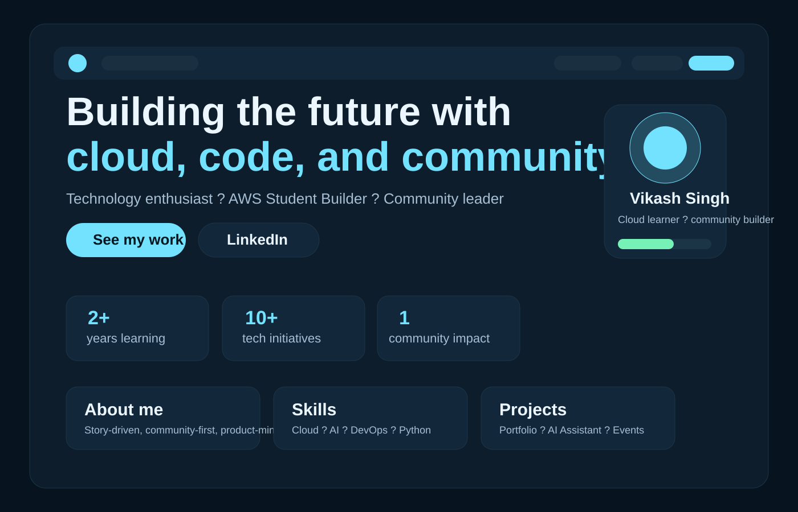
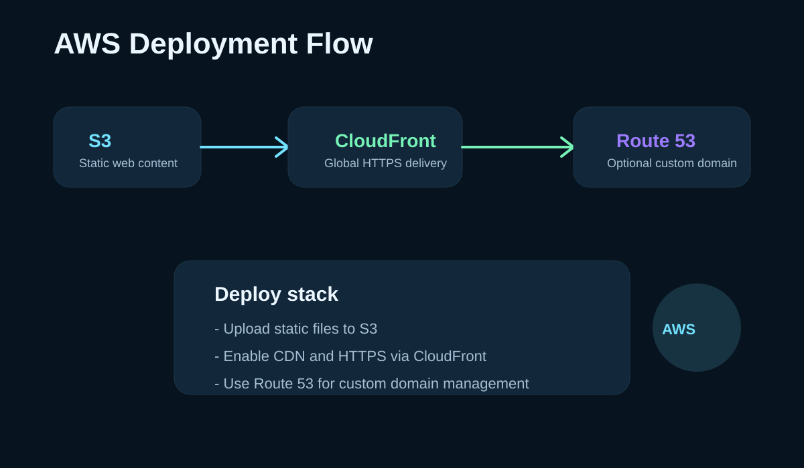

# Vikash Singh Portfolio

A polished personal portfolio for a cloud-focused student leader, community builder, and technology enthusiast. The site is built as a fast static website and designed to highlight an authentic story, skills, and projects while keeping navigation easy and smooth.

## Live site

- Local preview: `http://localhost:8000`
- AWS deployment target: S3 static website + CloudFront distribution (publicly accessible via CloudFront domain)

## Creative feature

The portfolio includes a clearly visible power-button hint that opens a hidden JARVIS-inspired mission panel. It reveals a personal story and core motto without disrupting the normal site flow.

## Project sections

- About Me
- Tech Superpowers
- Projects & Achievements
- GitHub and LinkedIn contact links

## AWS deployment approach

This project is designed for AWS-hosted delivery using:

- Amazon S3: host the static assets
- Amazon CloudFront: distribute the site globally with HTTPS and lower latency
- Route 53: optional custom domain management
- AWS Certificate Manager (ACM): TLS certificate for HTTPS

## Deployment workflow

1. Build the static files
2. Upload them to an S3 bucket
3. Enable static website hosting or CloudFront origin from S3
4. Attach a CloudFront distribution
5. Configure Route 53 if a custom domain is required

### Example deployment commands

```bash
aws s3 mb s3://vikash-portfolio-site --region us-east-1
aws s3 sync . s3://vikash-portfolio-site --delete --exclude "*.md" --exclude ".git/*"
aws cloudfront create-invalidation --distribution-id <DISTRIBUTION_ID> --paths "/*"
```

## Screenshots

### Portfolio home preview



### AWS deployment flow



## Lessons learned

- Portfolio storytelling matters as much as technical deliverables
- A hidden interaction can be memorable when it remains subtle and useful
- Static hosting on AWS is a fast, cost-effective way to ship a polished portfolio
- Good UX is a product in itself, especially when the content is personal and story-driven

## Repository links

- GitHub: https://github.com/vikash3221singh
- LinkedIn: https://www.linkedin.com/in/vikash-singh-5a611a402

## Running locally

```bash
python -m http.server 8000
```

Then open the browser to `http://localhost:8000`.
